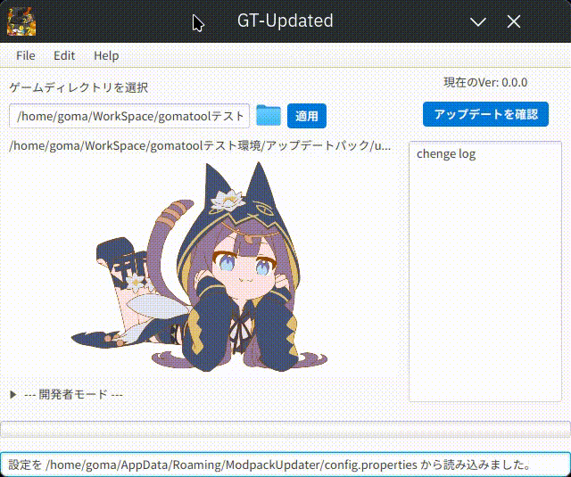

# GT updated

# ⚠️アーカイブされています！
これは、かつて私と友人達のMinecraftコミュニティ向けにバイブコーディングで作成したModpackのアップデートランチャー。
Modpackの更新作業のようにこのソフトウェアはGUI上で実行するファイル操作の自動化を得意としている。
またソースコードにはテスト用のHTTPクエリがハードコードされておりそのままでは利用できない状態です。

## 📝Feature
主な機能：  
- ワンクリック・アップデート
- ローカル実行、ダウンロード実行が可能
- クロスプラットフォーム対応(Windows10/11, ubuntu, macOS)

## 🤔How to Use?
複雑な設定は必要ありません。  
1.ゲームディレクトリを選択してください（次からは必要ありません）  
2.アップデートを確認ボタンをクリックしてください
